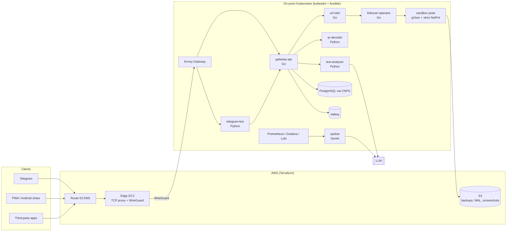

# Satark

**A scam-check assistant for everyday digital payments.**

Forward a suspicious SMS, link, QR code, phone number or UPI ID to Satark. In a few seconds you get a plain-language answer: how risky it looks, why, and what to do next. Answers come in English, Hindi or Kannada.

*Satark* (सतर्क) means "alert" or "vigilant" in Hindi.

> 🚧 **Status:** early stage. The design and roadmap are done and implementation is starting. See [CONTRIBUTING.md](CONTRIBUTING.md) for the phase-by-phase plan.

---

## Why Satark exists

Payment scams reach Indian phones every day, and most of them follow a handful of scripts:

- **Utility disconnection:** "Your electricity will be disconnected tonight at 9:30 PM. Call our officer immediately."
- **Fake KYC:** "Your bank account will be blocked today. Update your KYC here: bit.ly/…"
- **"Scan to receive" QR codes:** scanning a UPI QR and entering your PIN always *sends* money. You never need to do either to receive money.
- **Task and part-time job scams:** "Like YouTube videos, earn ₹3,000 a day."
- **Fake courier messages, "digital arrest" calls, and remote-access tricks** ("install AnyDesk so we can process your refund").

People fall for these because the messages look official and create panic, and in the moment there's no quick way to check. Reporting channels such as the **1930** helpline, **cybercrime.gov.in** and **Sanchar Saathi (Chakshu)** help after the fact. Satark is meant for the 30 seconds *before* someone taps the link or scans the code.

## What it does

| Feature | Description |
|---|---|
| **Check a message** | Redacts personal data, runs pattern rules, checks any links, asks an LLM for a classification, and replies with a risk level, reasons and next steps |
| **Check a link** | Expands short links and follows redirects, checks domain age, TLS certificate age, lookalike domains and threat feeds, then visits the page in an isolated sandbox to take a screenshot and detect password, OTP or card fields |
| **Check a QR code** | Decodes the QR. For UPI QRs it says exactly what scanning would do, e.g. "This SENDS ₹14,999 FROM your account to xyz123@examplebank" |
| **Look up a number or UPI ID** | Shows how many independent people reported it (masked and thresholded, never a "scammer" label) |
| **Report a scam** | Adds to community data and gives ready-to-copy details for 1930, cybercrime.gov.in and Chakshu |
| **Multilingual** | English, Hindi and Kannada at launch |

**Channels:** Telegram bot (first), a PWA with Android share-sheet support, and a rate-limited public REST API.

### Example

```
You:     "Dear Customer, your electricity connection will be disconnected
          tonight at 9:30 PM ... contact our electricity officer 98XXXXXX21"

Satark:  🔴 Likely scam (risk 91/100)
         • It gives a deadline of "tonight" to rush you
         • It asks you to call a personal mobile number, not an official helpline
         • Messages with this wording were reported 37 times this week

         What to do: don't call the number, check your bill on the official
         website or app, and report it on 1930 / cybercrime.gov.in / Chakshu.
```

### What Satark will not do

- Say something is "100% safe". The best verdict is "No red flags found".
- Ask for an OTP, PIN, password or card number.
- Label a person a scammer.
- Store message text unless the user opts in.

## Architecture

Satark has two layers:

- **Product layer:** the services that answer users' questions.
- **Platform layer:** a hybrid setup with an on-prem Kubernetes cluster and AWS, built the way a production infrastructure team would build it.



### Services

| Service | Language | Responsibility |
|---|---|---|
| `gateway-api` | Go | Public REST API, API keys, rate limiting, fan-out to analyzers, risk scoring |
| `telegram-bot` | Python | Conversation flow, language choice, follow-up buttons |
| `text-analyzer` | Python (FastAPI) | PII redaction, rule engine, LLM classification and explanations |
| `qr-decoder` | Python | QR decoding and UPI deep-link parsing |
| `url-intel` | Go | Redirect expansion, DNS/RDAP/TLS checks, lookalike detection, threat feeds |
| `reputation` | Go | Community reports for phone numbers, UPI IDs and domains |
| `linkscan-operator` | Go (kubebuilder) | Runs each suspicious link in a short-lived, isolated pod |
| `sandbox-browser` | Python + Playwright | Headless Chromium: redirects, screenshot, form detection |
| `feed-sync` | Python | CronJob that pulls threat feeds |
| `opsbot` | Python | GenAI on-call assistant that diagnoses platform alerts using runbooks |
| `web` | TypeScript | PWA frontend |

## Tech stack

| Area | Tools |
|---|---|
| Languages | Go, Python, TypeScript, Bash, PowerShell |
| Containers | Docker, containerd, gVisor |
| Kubernetes | kubeadm (on-prem), Cilium + Hubble, MetalLB, Envoy Gateway (Gateway API), cert-manager, KEDA |
| Packaging and delivery | Helm, Argo CD (GitOps), GitHub Actions, GHCR |
| Infrastructure as Code | Terraform (AWS), Ansible, Vagrant |
| Cloud | AWS: S3, IAM (GitHub OIDC), EC2, Route 53, CloudWatch, optional Bedrock |
| Data | PostgreSQL (CloudNativePG + pgvector), Valkey, NATS JetStream |
| Observability | Prometheus, Grafana, Loki, Grafana Alloy, Alertmanager |
| Security | Kyverno, Pod Security Admission, Trivy, cosign, Syft, kube-bench, Sealed Secrets, gitleaks |
| Reliability | Velero, CNPG backups, k6, scripted game days |
| GenAI | Pluggable LLM providers (local Ollama, Amazon Bedrock, hosted APIs), RAG over runbooks |

## Planned repository layout

```
satark/
├── apps/            # gateway-api, url-intel, text-analyzer, qr-decoder, telegram-bot, ...
├── tools/           # kubectl-satark plugin
├── charts/          # Helm library chart + per-service charts
├── gitops/          # Argo CD bootstrap, platform components, dev/prod environments
├── infra/
│   ├── vagrant/     # on-prem VMs
│   ├── ansible/     # roles and playbooks for cluster lifecycle
│   └── terraform/   # AWS modules and environments
├── policies/        # Kyverno and custom IaC policies
├── rules/           # scam-detection rules (YAML)
├── eval/            # labelled dataset + LLM evaluation harness
├── tests/           # load and chaos tests
├── scripts/         # host setup and bootstrap
└── docs/            # ADRs, runbooks, SOPs, game days, sprint notes
```

## Getting started

The setup instructions will land here as each phase is finished. The planned local setup is:

1. **Host tools:** VirtualBox, Vagrant, Git and WSL2. On Windows, `scripts/setup-host.ps1` will install them.
2. **Cluster:** `scripts/bootstrap.sh` brings up three Ubuntu VMs and runs the Ansible `site.yml` playbook to build a kubeadm cluster.
3. **Platform and apps:** Argo CD syncs everything else from `gitops/`.

Recommended hardware: 16 GB RAM for the three-node cluster. With 8 GB you can run two nodes.

## Roadmap

| Phase | Focus |
|---|---|
| 0 | Planning and repository setup |
| 1 | On-prem Kubernetes foundations |
| 2 | Product MVP: core services |
| 3 | Data layer and Helm packaging |
| 4 | GitOps and CI/CD |
| 5 | Cloud infrastructure with Terraform |
| 6 | Observability |
| 7 | Link intelligence |
| 8 | Sandbox operator |
| 9 | Security and compliance |
| 10 | GenAI |
| 11 | Reliability, backups and disaster recovery |
| 12 | Polish, documentation and launch |

## Contributing

Contributions are welcome. Please read [CONTRIBUTING.md](CONTRIBUTING.md) for the workflow, conventions and project timeline.

## Disclaimer

Satark gives a risk assessment, not a guarantee. It can be wrong. Banks and government bodies never ask for your OTP, UPI PIN or password. If you've lost money to a scam, call **1930** or report it at **cybercrime.gov.in** as soon as possible.

## License

Released under the [MIT License](LICENSE).
