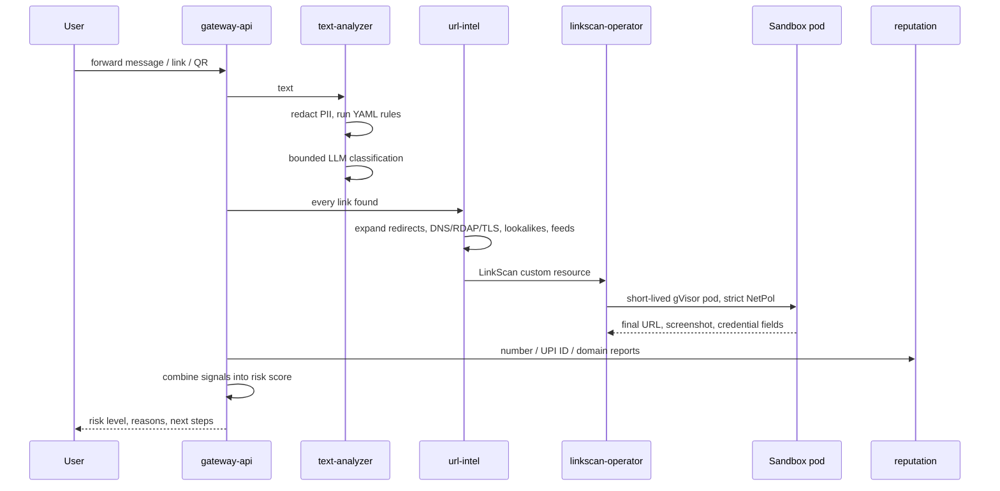

# Satark

**A scam-check assistant for everyday digital payments — forward it the message before you tap the link.**

[](.github/workflows)
[](apps/gateway-api/go.mod)
[](apps/text-analyzer/pyproject.toml)
[](infra/ansible)
[](infra/terraform)
[](CONTRIBUTING.md#project-timeline)
[](LICENSE)

Forward a suspicious SMS, link, QR code, phone number or UPI ID to Satark. In a
few seconds you get a plain-language answer: how risky it looks, why, and what
to do next — in English, Hindi or Kannada. *Satark* (सतर्क) means "alert" or
"vigilant" in Hindi.

Reporting channels such as the **1930** helpline, **cybercrime.gov.in** and
**Sanchar Saathi (Chakshu)** help after the fact. Satark is meant for the 30
seconds *before* someone taps the link or scans the code.

---

## Contents

| Section | |
|---|---|
| [What it does](#what-it-does) | The feature surface, by area |
| [Architecture](#architecture) | Product layer, platform layer, hybrid cloud |
| [How a check travels](#how-a-check-travels) | Redact, analyse, sandbox, score |
| [Quick start](#quick-start) | The API on your laptop, then the full cluster |
| [Project status](#project-status) | Every phase, and the twelve open items |
| [Design decisions](#design-decisions) | The tradeoffs, and why |
| [Repository layout](#repository-layout) | Where things live |
| [Documentation](#documentation) | Which file answers which question |
| [Team](#team) | Who built it |

---

## What it does

| Area | Capabilities |
|---|---|
| **Messages** | PII redaction, YAML pattern rules, bounded LLM classification, risk level with reasons and next steps |
| **Links** | Redirect expansion, domain and TLS age, lookalike detection, threat feeds, then a visit in an isolated sandbox with a screenshot and password/OTP/card field detection |
| **QR codes** | Decodes the QR and, for UPI, says exactly what scanning would do: "This SENDS ₹14,999 FROM your account to xyz123@examplebank" |
| **Reputation** | How many independent people reported a number, UPI ID or domain — masked and thresholded, never a "scammer" label |
| **Reporting** | Adds to community data and gives ready-to-copy details for 1930, cybercrime.gov.in and Chakshu |
| **Channels** | Telegram bot, a PWA with Android share-sheet support, and a rate-limited public REST API |
| **Platform** | kubeadm cluster built by Ansible, Argo CD GitOps, Terraform on AWS, WireGuard edge, Prometheus/Grafana/Loki |
| **Operations** | SLOs with error budgets, 13 runbooks, SOPs, scripted game days, and `opsbot`, a RAG on-call assistant over the runbooks |

### Example

```
You:     "Dear Customer, your electricity connection will be disconnected
          tonight at 9:30 PM ... contact our electricity officer 98XXXXXX21"

Satark:  🔴 Likely scam (risk 91/100)
         • It gives a deadline of "tonight" to rush you
         • It asks you to call a personal mobile number, not an official helpline
         • Messages with this wording were reported 37 times this week

         What to do: don't call the number, check your bill on the official
         website or app, and report it on 1930 / cybercrime.gov.in / Chakshu.
```

### What Satark will not do

- Say something is "100% safe". The best verdict is "No red flags found".
- Ask for an OTP, PIN, password or card number.
- Label a person a scammer.
- Store message text unless the user opts in.

---

## Architecture

Two layers. The **product layer** is the services that answer users' questions.
The **platform layer** is a hybrid setup — an on-prem Kubernetes cluster and AWS —
built the way a production infrastructure team would build it.


Public traffic lands on an edge EC2 instance and crosses a **WireGuard tunnel**
into the Envoy Gateway, so the on-prem cluster is never exposed to the internet
directly.

### Services

| Service | Language | Responsibility |
|---|---|---|
| `gateway-api` | Go | Public REST API, API keys, rate limiting, fan-out to analyzers, risk scoring |
| `telegram-bot` | Go | Conversation flow, language choice, follow-up buttons |
| `text-analyzer` | Python (FastAPI) | PII redaction, rule engine, LLM classification and explanations |
| `qr-decoder` | Python | QR decoding and UPI deep-link parsing |
| `url-intel` | Go | Redirect expansion, DNS/RDAP/TLS checks, lookalike detection, threat feeds |
| `reputation` | Go | Community reports for phone numbers, UPI IDs and domains |
| `linkscan-operator` | Go (kubebuilder) | Runs each suspicious link in a short-lived, isolated pod |
| `sandbox-browser` | Python + Playwright | Headless Chromium: redirects, screenshot, form detection |
| `feed-sync` | Go | CronJob that pulls threat feeds |
| `opsbot` | Python | GenAI on-call assistant that diagnoses platform alerts using runbooks |
| `pwa` | TypeScript | PWA frontend |

---

## How a check travels



The LLM sees **redacted text only**, and its vote is one bounded input to the
score — rules and evidence can always overrule it
([ADR-005](docs/adr/ADR-005-bounded-llm-influence.md)).

---

## Quick start

> Building the full platform? [CONTRIBUTING.md](CONTRIBUTING.md) is the
> phase-by-phase procedure and [docs/sops/](docs/sops/) holds the operating steps.
> This is only the local shape.

```bash
# 1 — the API on your laptop (Docker Compose, hardened containers)
cp .env.example .env                     # add TELEGRAM_BOT_TOKEN to run the bot
docker compose up --build                # API only: http://localhost:8080
docker compose --profile bot up --build  # API + Telegram bot

# 2 — try it
curl -s localhost:8080/v1/scan/text -H 'content-type: application/json' \
  -d '{"text":"Your electricity will be disconnected tonight. Call officer 98XXXXXX21","lang":"en"}'
curl -s localhost:8080/v1/scan/qr -F image=@apps/qr-decoder/tests/fixtures/upi_receive_scam.png

# 3 — the full cluster: host tools, three Ubuntu VMs, kubeadm via Ansible
./scripts/setup-host.ps1                 # Windows: VirtualBox, Vagrant, Git, WSL2
./scripts/bootstrap.sh                   # VMs + Ansible site.yml
./scripts/verify-cluster.sh

# 4 — everything else syncs from gitops/ through Argo CD
./scripts/smoke-test.sh
```

Recommended hardware: 16 GB RAM for the three-node cluster. With 8 GB you can
run two nodes.

---

## Project status

**283 of 293 subtasks are complete.** Phases 0–4 produce a working MVP: a
Telegram bot that checks messages and QR codes, running on a GitOps-managed
on-prem cluster.

```mermaid
gantt
    title Delivery — 13 phases
    dateFormat X
    axisFormat %s
    section Foundation
    Phase 0 · planning and repo setup          :done, 0, 1
    Phase 1 · on-prem Kubernetes               :done, 1, 2
    Phase 2 · product MVP                      :done, 2, 3
    Phase 3 · data layer and Helm              :done, 3, 4
    Phase 4 · GitOps and CI/CD                 :done, 4, 5
    section Cloud and insight
    Phase 5 · Terraform on AWS                 :active, 5, 6
    Phase 6 · observability                    :done, 6, 7
    Phase 7 · link intelligence                :done, 7, 8
    Phase 8 · sandbox operator                 :done, 8, 9
    section Hardening
    Phase 9 · security and compliance          :active, 9, 10
    Phase 10 · GenAI                           :done, 10, 11
    Phase 11 · reliability and DR              :active, 11, 12
    Phase 12 · polish and launch               :active, 12, 13
```



| Phase | Focus | Done |
|---|---|:---:|
| 0 | Planning and repository setup | ✅ 21/21 |
| 1 | On-prem Kubernetes foundations | ✅ 25/25 |
| 2 | Product MVP (core services) | ✅ 26/26 |
| 3 | Data layer and Helm packaging | ✅ 20/20 |
| 4 | GitOps and CI/CD | ✅ 19/19 |
| 5 | Cloud infrastructure with Terraform | 23/24 |
| 6 | Observability | ✅ 20/20 |
| 7 | Link intelligence | ✅ 19/19 |
| 8 | Sandbox operator | ✅ 25/25 |
| 9 | Security and compliance | 19/20 |
| 10 | GenAI | ✅ 25/25 |
| 11 | Reliability, backups and disaster recovery | 27/31 |
| 12 | Polish, documentation and launch | 14/18 |

**The ten open items are not code.** Each needs a live cluster, a cloud
account or a real-world action; its script, procedure and report template are
already in the repo.

| Kind | Items |
|---|---|
| Needs the AWS account | 5.1 account setup · 9.17 IAM Access Analyzer |
| Needs the live cluster and backups | 11.15 DR drill · 11.20 and 11.27 game days · 11.30 opsbot time-to-diagnose |
| Needs the deployed app or a person | 12.14 screenshots · 12.17 launch · 12.18 KPIs · 12.19 monthly scam-trends report |

### What the load tests found

| Run | Breaking rate | What broke |
|---|---|---|
| Baseline | ~95 req/s | `worker-2` at 96% CPU, soft lockups, node `NotReady` — pods had piled onto one node |
| After the fix | **≥ 160 req/s** | Nothing in the cluster; the host ran out of CPU first |

Full write-up: [docs/game-days/load-test-bottleneck.md](docs/game-days/load-test-bottleneck.md).
The SLOs it is measured against — **99.5% availability** and **95% of requests
under 800 ms**, both over 30 days — are in
[docs/observability/slos.md](docs/observability/slos.md).

### What CI proves on every push

| Workflow | Proves |
|---|---|
| `go` · `python` | Every Go module and Python project lints and passes its tests |
| `build` | Every service image builds; dev tags are bumped for Argo CD |
| `helm` | Every chart lints and renders valid manifests |
| `kyverno-test` | Admission policies accept the good fixtures and reject the bad ones |
| `terraform` · `terraform-plan` | fmt, validate, tflint, Trivy and Checkov pass; plans run with a read-only role |
| `eval` | The labelled scam dataset still meets the rule and LLM quality gates |
| `gitleaks` · `secrets-guard` | No credentials and no unsealed Kubernetes secrets reach the repo |
| `zap-baseline` | Scheduled OWASP ZAP baseline scan of the public API |

---

## Design decisions

**kubeadm, not k3s.** The point is to run the cluster lifecycle — upgrades, node
replacement, certificate rotation — the way a real platform team does
([ADR-001](docs/adr/ADR-001-kubeadm-over-k3s.md)).

**Gateway API, not ingress-nginx.** A typed, role-split routing model with
Envoy Gateway behind it ([ADR-002](docs/adr/ADR-002-gateway-api-over-ingress-nginx.md)).

**CloudNativePG, not RDS.** The database lives next to the services, with WAL and
backups shipped to S3 ([ADR-004](docs/adr/ADR-004-cloudnativepg-over-rds.md)).

**The LLM gets a bounded vote.** It reads redacted text and cannot push a score
past what the rules and evidence support. A model outage degrades explanations,
not verdicts ([ADR-005](docs/adr/ADR-005-bounded-llm-influence.md)).

**Suspicious links never run in a shared process.** Every scan is its own
short-lived gVisor pod with strict network policy and an SSRF-tested
boundary ([ADR-006](docs/adr/ADR-006-sandbox-isolation-model.md)).

**Pull-based GitOps.** CI never holds cluster credentials; Argo CD pulls the
desired state from `gitops/` ([ADR-007](docs/adr/ADR-007-pull-based-gitops.md)).

---

## Repository layout

```
.
├── apps/            gateway-api, telegram-bot, text-analyzer, qr-decoder, url-intel, reputation,
│                    linkscan-operator, sandbox-browser, feed-sync, opsbot, pwa
├── libs/            shared Go and Python packages
├── charts/          Helm library chart + per-service charts
├── gitops/          Argo CD bootstrap, platform components, dev/prod environments
├── infra/           Ansible roles and playbooks, Terraform modules and environments
├── policies/        Kyverno and Checkov policies
├── rules/           scam-detection rules (YAML)
├── eval/            labelled dataset + LLM evaluation harness
├── tests/           k6 load tests and chaos / game-day scripts
├── tools/           kubectl-satark plugin
├── scripts/         host setup, bootstrap, drills, sealing, reports
└── docs/            ADRs, runbooks, SOPs, game days, compliance, launch
```

---

## Documentation

| Question | File |
|---|---|
| *Is the task done?* | [CONTRIBUTING.md § Project timeline](CONTRIBUTING.md#project-timeline) |
| *How do the pieces fit?* | [docs/architecture.md](docs/architecture.md) |
| *Why was it built this way?* | [docs/adr/](docs/adr/) |
| *How do I call the API?* | [docs/api/](docs/api/) · [reputation.openapi.yaml](docs/api/reputation.openapi.yaml) |
| *An alert fired* | [docs/runbooks/](docs/runbooks/) |
| *How do I upgrade, add a node or rotate secrets?* | [docs/sops/](docs/sops/) |
| *What happens when it breaks?* | [docs/game-days/](docs/game-days/) |
| *What are the SLOs?* | [docs/observability/slos.md](docs/observability/slos.md) |
| *What data is kept, and for how long?* | [docs/compliance/data-retention.md](docs/compliance/data-retention.md) · [docs/privacy-policy.md](docs/privacy-policy.md) |
| *How do I report a vulnerability?* | [SECURITY.md](SECURITY.md) |

---

## Disclaimer

> [!IMPORTANT]
> Satark gives a risk assessment, not a guarantee. It can be wrong.
>
> Banks and government bodies **never** ask for your OTP, UPI PIN or password.
> If you have lost money to a scam, call **1930** or report it at
> **cybercrime.gov.in** as soon as possible.

---

## Team

| Member | Focus |
|---|---|
| **Guru R Bharadwaj** | Design, every service, the platform, and operations |

Contributions are welcome — pick a ❌ task in [CONTRIBUTING.md](CONTRIBUTING.md)
and open an issue that references its number.

---

## License

[MIT](LICENSE).
