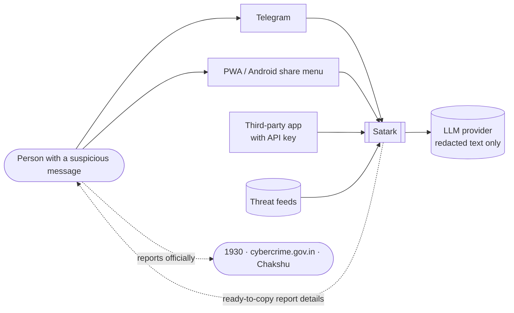
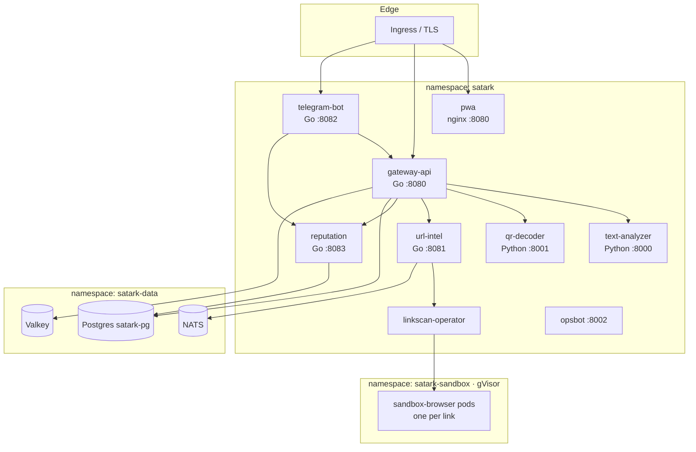
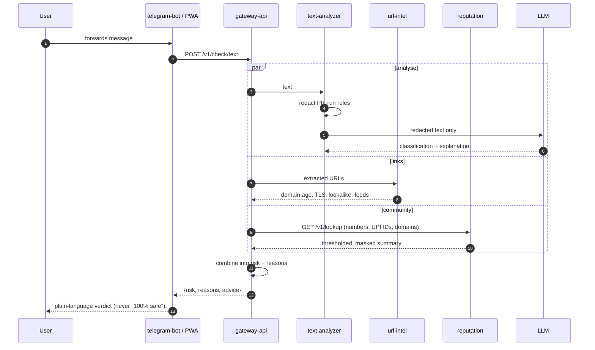
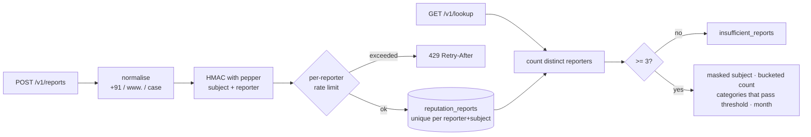
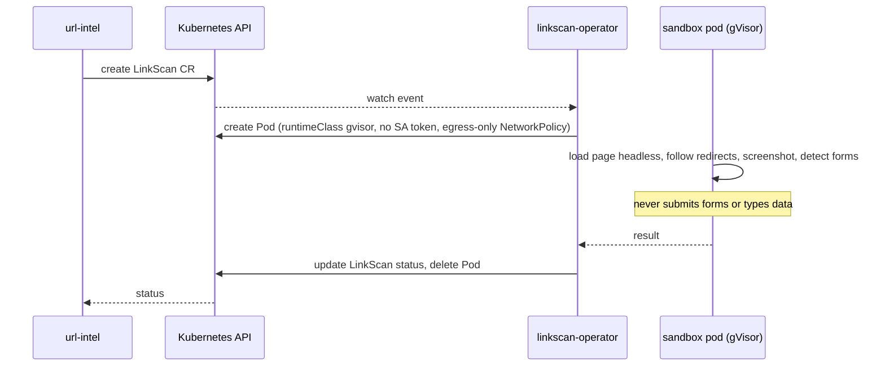
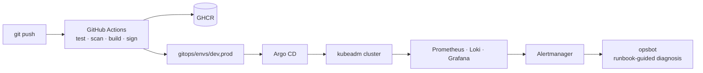

# Satark architecture

This document explains how Satark is put together: the request paths, where data lives, how untrusted links are isolated, and how the platform is operated. Diagrams are Mermaid and render on GitHub.

## 1. Context

Satark never reports to authorities on a user's behalf; it gives the user the details and the right channel.

## 2. Containers

| Service | Responsibility | State |
|---|---|---|
| `gateway-api` | Public API, API keys, per-key rate limits, fan-out, risk scoring | `api_keys` in Postgres, counters in Valkey |
| `telegram-bot` | Conversation, language, report flow, `/forget` | per-user settings |
| `text-analyzer` | PII redaction, rules (`rules/{en,hi,kn}.yaml`), LLM classification | none |
| `qr-decoder` | QR decoding, UPI deep-link parsing | none |
| `url-intel` | Redirects, DNS/RDAP/TLS, lookalikes, feeds | feed cache |
| `reputation` | Community reports, thresholds, delisting | `reputation_*` tables |
| `linkscan-operator` + `sandbox-browser` | Open a link in a throwaway, isolated pod | screenshots (7 days) |
| `pwa` | Web front end and Android share target | none server-side |

## 3. Checking a message

Timeouts are per branch: a slow LLM or sandbox degrades the answer (fewer reasons) rather than failing it.

## 4. Community reports

- No raw phone numbers, VPAs or user IDs are stored. Without the pepper (a Kubernetes secret), hashes can't be linked back.
- A single person can't make something appear: the threshold counts distinct reporters, and each category must pass it separately.
- Owners can ask for review (SOP-07). Approval deletes the reports.
- `/forget` deletes a reporter's reports; retention deletes everything after 365 days.

## 5. Link sandboxing

## 6. Data and privacy

See [privacy policy](privacy-policy.md) and [data retention](compliance/data-retention.md). In short: check inputs aren't stored; PII is redacted before any LLM call; reports are hashed, thresholded and masked; `/forget` and a daily retention CronJob delete data.

## 7. Platform

- **Infrastructure:** Terraform (`infra/terraform`) and Ansible (`infra/ansible`) build a kubeadm cluster; Vagrant gives a local copy.
- **Delivery:** every service ships a Helm chart on `charts/satark-common`; Argo CD syncs `gitops/envs/*`.
- **Policy:** Kyverno (`policies/kyverno`) enforces non-root, signed images and resource limits; Checkov scans IaC.
- **Observability:** every service exposes `/healthz`, `/readyz` and `/metrics` with the `satark_` prefix.
- **Operations:** runbooks in `docs/runbooks`, procedures in `docs/sops`, decisions in `docs/adr`.
